# Results: SOH estimation on MIT-Stanford-TRI and NASA PCoE

_Auto-generated by `python -m soh.report` from `reports/results/`. All errors are in **% SOH** (SOH = QD / 1.1 Ah x 100). Mean ± std over seeds [0, 1, 2]; cell-wise official split (41 train / 43 primary / 40 secondary cells)._

## 1. Data and cleaning (O1)

| Step | Rows / count |
|---|---|
| Raw per-cycle rows (124 cells after official cleaning, 140 raw) | 100,501 |
| Dropped: cycle 1 | 124 |
| Dropped: impossible QD (<=0 or >1.2 Ah) | 4 |
| Flagged QD spikes (removed from TRAINING only) | 243 |
| Flagged IR glitches (set NaN, carried forward) | 29 |
| Flagged temperature excursions (set NaN, carried forward) | 85 |
| Clean rows | 100,373 |
| Cells per split | test_primary: 43, test_secondary: 40, train: 41 |
| Rows per split | test_secondary: 41,200, test_primary: 31,034, train: 28,139 |

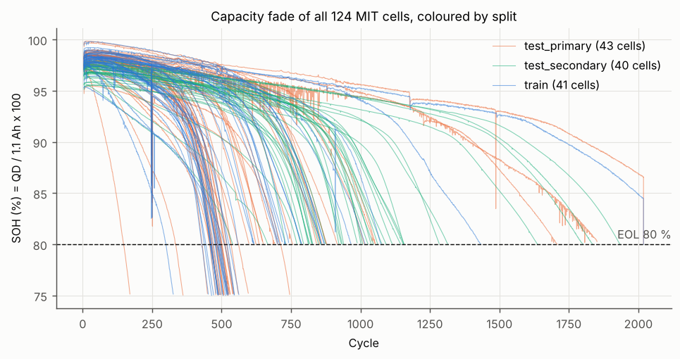

## 2. Leakage audit (O2)

Each feature alone, on training cells only. `r2_single_cv` = cross-cell R² of a 1-feature tree (GroupKFold by cell). Threshold calibrated on known disguised labels: **R² ≥ 0.922 ⇒ label-equivalent**. Rolling-mean (`_rm5`) copies inherit their parent's status and are omitted here.

| Feature | Family | Spearman (pooled) | Spearman (within cell) | Single-feature R² | Status | Meaning |
|---|---|---|---|---|---|---|
| IR | F1 resistance | -0.55 | -0.85 | 0.534 | safe | Internal resistance rises as electrodes/electrolyte age |
| Tavg | F2 temperature | -0.18 | -0.68 | -0.049 | safe | Aged cells self-heat more for the same current |
| Tmin | F2 temperature | -0.02 | -0.17 | -0.007 | safe | Cycle minimum can temperature |
| Tmax | F2 temperature | -0.25 | -0.75 | -0.033 | safe | Cycle maximum can temperature |
| Trange | F2 temperature | -0.28 | -0.87 | -0.029 | safe | Tmax - Tmin: heating swing within a cycle |
| d_IR | F3 change vs new | -0.66 | -0.85 | 0.779 | safe | IR minus the cell's own early-life baseline |
| d_Tavg | F3 change vs new | -0.36 | -0.68 | 0.153 | safe | Tavg minus early-life baseline |
| chg_v_start | F4 1C charge segment | -0.71 | -1.00 | 0.817 | caution | Lowest voltage in the 1C phase (after relaxation): overpotential + true SOC |
| chg_t_cv | F4 1C charge segment | -0.12 | -0.36 | 0.472 | caution | Duration of the 3.6 V constant-voltage taper (kinetics) |
| chg_q_cv | F4 1C charge segment | -0.03 | -0.36 | 0.431 | caution | Charge accepted during the CV taper |
| chg_cv_tau | F4 1C charge segment | -0.17 | -0.37 | 0.545 | caution | Time for CV current to halve from 1C (diffusion/resistance) |
| chg_dT | F4 1C charge segment | -0.23 | 0.02 | -0.086 | caution | Temperature change over the 1C+CV segment |
| d_chg_v_start | F3 change vs new | -0.89 | -1.00 | 0.890 | caution | chg_v_start minus baseline |
| d_chg_t_cv | F3 change vs new | -0.04 | -0.36 | 0.498 | caution | chg_t_cv minus baseline |
| d_chg_cv_tau | F3 change vs new | -0.15 | -0.37 | 0.501 | caution | chg_cv_tau minus baseline |
| chg_ic_peak | F5 charge IC | 0.92 | 1.00 | 0.897 | caution | Height of dQ/dV peak on the 1C segment (graphite staging) |
| chg_ic_peak_v | F5 charge IC | -0.85 | -0.96 | 0.734 | caution | Voltage of that peak; shifts with LLI/LAM |
| d_chg_ic_peak | F3 change vs new | 0.89 | 1.00 | 0.742 | caution | chg_ic_peak minus baseline |
| dq_var_log | F6 partial dQ(V) | -0.86 | -0.98 | 0.835 | caution | log10 var of Q_k(V)-Q_10(V), 3.3-2.9 V (Severson's key feature) |
| dq_min_log | F6 partial dQ(V) | -0.87 | -0.99 | 0.848 | caution | log10 |min| of the same curve difference |
| dq_mean | F6 partial dQ(V) | 0.84 | 0.97 | 0.823 | caution | Mean of the curve difference in the partial window |
| chargetime | F7 protocol | -0.52 | -0.83 | 0.071 | ablation | Total charge time: mostly encodes which of 72 policies was used |
| cycle | F9 age | -0.74 | -1.00 | 0.288 | ablation | Cycle count: shortcut, lifetimes span 150-2,300 cycles |
| QD | X1 label | 1.00 | 1.00 | 1.000 | EXCLUDED (physics/definition) | IS the label |
| QC | X2 charge capacity | 1.00 | 1.00 | 0.999 | EXCLUDED (physics/definition) | Coulombic efficiency ~1 so QC ~ QD |
| dis_time | X3 discharge time | 0.95 | 1.00 | 0.943 | EXCLUDED (physics/definition) | Q = I*t with I fixed at 4.4 A |
| dis_energy | X4 discharge energy | 0.94 | 1.00 | 0.932 | EXCLUDED (physics/definition) | Capacity x nearly constant LFP voltage |
| chg_t_cc | X* 1C CC duration | 0.98 | 1.00 | 0.947 | EXCLUDED (physics/definition) | Charge starts from empty, fast phase stops at 0.88 Ah, so 1C time ~ (QC-0.88)/1.1 A |
| chg_q_cc | X* 1C CC charge | 0.98 | 1.00 | 0.949 | EXCLUDED (physics/definition) | = QC - 0.88 Ah - CV charge: capacity in disguise |

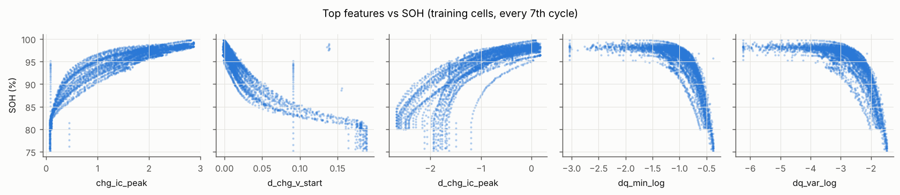

## 3. Main results — template R1 (O3)

| Model | Features | Primary RMSE | Primary MAE | Primary MAPE % | Primary R² | Secondary RMSE | Secondary MAE | EOL-band (80–85 %) RMSE prim. | EOL-band RMSE sec. | Mean \|EOL error\| prim. (cycles, alarmed cells) | Missed EOL alarms prim. | Missed EOL alarms sec. | Worst-cell RMSE prim. | Worst-cell RMSE sec. |
|---|---|---|---|---|---|---|---|---|---|---|---|---|---|---|
| Dummy (mean) | A4_plus_history | 5.14 | 3.97 | 4.40 | -0.000 | 4.01 | 2.87 | 11.43 | 11.46 | nan | 43 / 43 | 40 / 40 | 8.35 | 5.99 |
| XGBoost | A0_cycle_only | 4.06 ± 0.00 | 2.87 ± 0.00 | 3.19 ± 0.00 | 0.376 ± 0.000 | 3.53 ± 0.00 | 2.69 ± 0.00 | 7.80 ± 0.00 | 8.05 ± 0.00 | nan | 43 / 43 | 40 / 40 | 10.95 ± 0.00 | 5.43 ± 0.00 |
| Ridge | A4_plus_history | 1.14 | 0.73 | 0.80 | 0.950 | 5.88 | 5.74 | 2.12 | 4.39 | 11 | 6 / 43 | 40 / 40 | 3.75 | 8.95 |
| Random Forest | A4_plus_history | 1.20 ± 0.01 | 0.35 ± 0.00 | 0.39 ± 0.00 | 0.945 ± 0.001 | 2.46 ± 0.07 | 1.86 ± 0.05 | 2.42 ± 0.01 | 3.25 ± 0.09 | 3 ± 0 | 16 / 43 | 40 / 40 | 6.45 ± 0.05 | 4.36 ± 0.11 |
| XGBoost | A4_plus_history | 1.22 ± 0.01 | 0.35 ± 0.00 | 0.39 ± 0.00 | 0.943 ± 0.001 | 3.00 ± 0.15 | 2.12 ± 0.12 | 2.46 ± 0.02 | 3.63 ± 0.05 | 5 ± 0 | 11 / 43 | 40 / 40 | 6.48 ± 0.03 | 5.14 ± 0.16 |
| LSTM (k=10) | A3 windows | 1.09 ± 0.03 | 0.44 ± 0.03 | 0.49 ± 0.04 | 0.955 ± 0.002 | 4.05 ± 0.30 | 3.68 ± 0.32 | 2.27 ± 0.09 | 2.51 ± 0.05 | 3 ± 0 | 19 / 43 | 40 / 40 | 5.81 ± 0.17 | 5.61 ± 0.42 |
| GRU (k=10) | A3 windows | 1.15 ± 0.02 | 0.41 ± 0.00 | 0.46 ± 0.00 | 0.950 ± 0.001 | 4.17 ± 0.21 | 3.78 ± 0.19 | 2.45 ± 0.03 | 2.71 ± 0.21 | 3 ± 0 | 21 / 43 | 40 / 40 | 6.26 ± 0.15 | 5.87 ± 0.24 |
| 1D-CNN (k=10) | A3 windows | 0.97 ± 0.05 | 0.47 ± 0.02 | 0.52 ± 0.02 | 0.964 ± 0.004 | 4.46 ± 0.65 | 4.21 ± 0.67 | 2.05 ± 0.11 | 2.37 ± 0.65 | 6 ± 1 | 16 / 43 | 37 / 40 | 4.24 ± 0.30 | 5.75 ± 0.58 |

EOL error uses an alarm at 80.5 % SOH (batch-3 cells stop at 80.0–80.15 %, so a strict 80 % crossing never occurs there). It is computed on raw, unsmoothed per-cycle estimates, so a single noisy low estimate triggers an early alarm. A **missed alarm** = the cell truly crossed the alarm level but the estimate never did (the model is optimistic near end of life) — the dangerous failure mode for a BMS.

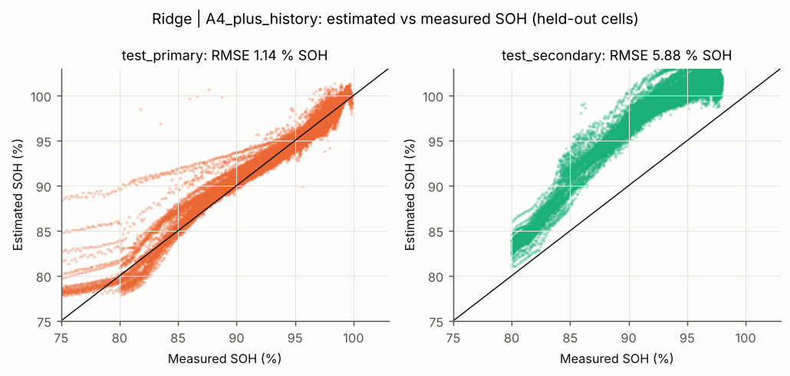

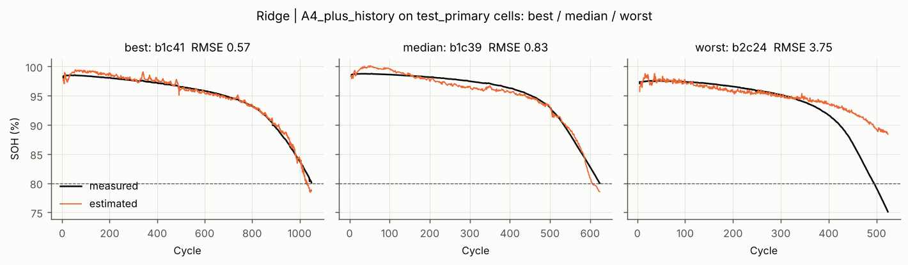

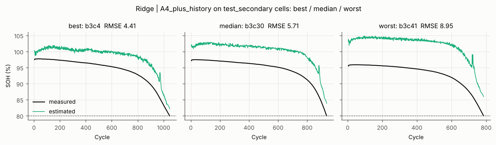

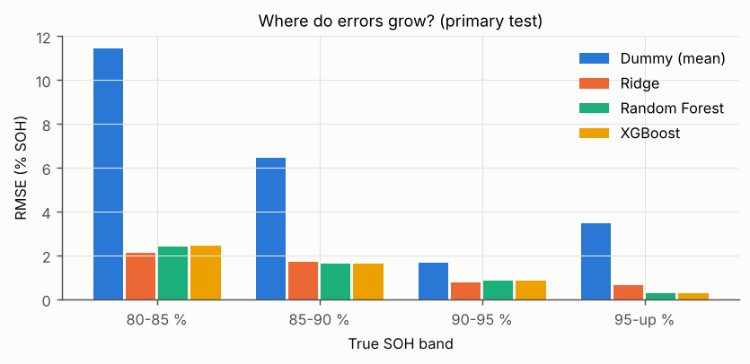

**Tuned hyper-parameters** (RandomizedSearchCV, GroupKFold(5) on training cells):

| Model | Inner-CV RMSE | Best parameters |
|---|---|---|
| xgb|A0_cycle_only | 4.310 | `{"colsample_bytree": 0.8740174516716872, "learning_rate": 0.06315256316915974, "max_depth": 4, "min_child_weight": 15, "n_estimators": 300, "subsample": 0.8164039584150213}` |
| ridge|A4_plus_history | 1.075 | `{"m__alpha": 46.659545670218456}` |
| rf|A4_plus_history | 0.813 | `{"m__max_depth": null, "m__max_features": 0.5, "m__min_samples_leaf": 1}` |
| xgb|A4_plus_history | 0.772 | `{"colsample_bytree": 0.717425859940308, "learning_rate": 0.0314152878208228, "max_depth": 6, "min_child_weight": 6, "n_estimators": 1000, "subsample": 0.728070156082529}` |

**Deep-model window length** (LSTM, seed 0):

| k (cycles) | Primary RMSE | Secondary RMSE |
|---|---|---|
| 5 | 1.12 | 4.02 |
| 10 | 1.05 | 4.33 |
| 20 | 1.03 | 3.55 |
| 30 | 1.02 | 4.35 |

## 4. Ablation ladder — template R2 (XGBoost, tuned once on A4)

| Step | Primary RMSE | Secondary RMSE | Δ primary vs A4 |
|---|---|---|---|
| A0_cycle_only | 4.06 ± 0.00 | 3.53 ± 0.00 | +2.84 |
| A1_IR_temp | 2.53 ± 0.02 | 3.31 ± 0.04 | +1.31 |
| A2_bms_charge | 1.24 ± 0.00 | 1.88 ± 0.19 | +0.02 |
| A3_plus_dQV | 1.20 ± 0.00 | 2.04 ± 0.09 | -0.02 |
| A4_plus_history | 1.22 ± 0.01 | 3.00 ± 0.15 | +0.00 |
| A5_A4+chargetime | 1.16 ± 0.01 | 3.07 ± 0.07 | -0.06 |
| A6_A4+cycle | 1.22 ± 0.01 | 2.83 ± 0.08 | -0.00 |
| A7_A4_random_row_split | (pooled random-row test) 0.15 ± 0.00 | - | -1.07 |

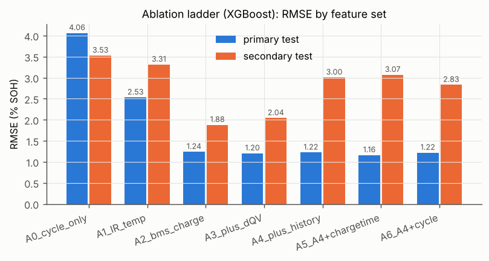

## 5. Leakage demonstration — template R3 (O4)

Same 84 cells (train + primary), same model, 50 % held out either as random **rows** or as whole **cells**.

| Model | Random-row split RMSE | Cell-wise split RMSE | Inflation factor |
|---|---|---|---|
| rf | 0.162 ± 0.003 | 0.651 ± 0.382 | 4.0x |
| xgb | 0.147 ± 0.003 | 0.555 ± 0.304 | 3.8x |

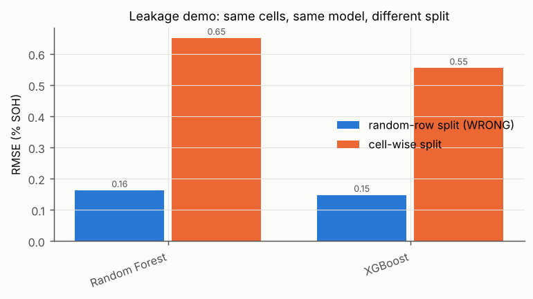

**Robustness:** XGBoost (A4) over 10 random 80/20 *cell* splits of all 124 cells: RMSE 0.515 ± 0.104 % SOH (range 0.33–0.66).

## 6. NASA — template R4 (O5)

| Model | Setting | B0005 | B0006 | B0007 | B0018 | Mean ± std |
|---|---|---|---|---|---|---|
| ridge | NASA LOBO (label soh) | 4.31 | 9.94 | 5.89 | 13.41 | 8.39 ± 3.55 |
| rf | NASA LOBO (label soh) | 6.09 | 9.73 | 3.43 | 18.53 | 9.44 ± 5.70 |
| xgb | NASA LOBO (label soh) | 5.62 | 9.46 | 2.44 | 16.92 | 8.61 ± 5.40 |
| rf | MIT → NASA zero-shot (soh_init); MIT sanity 1.91 | 9.13 | 17.32 | 6.54 | 15.52 | 12.13 ± 4.43 |
| xgb | MIT → NASA zero-shot (soh_init); MIT sanity 1.90 | 8.10 | 16.05 | 5.67 | 16.01 | 11.46 ± 4.65 |

NASA labels go down to 57.7 % SOH (56.7 % soh_init); MIT training labels only reach 76.4 % soh_init, and trees cannot extrapolate below their lowest training label.

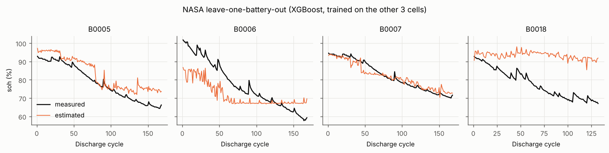

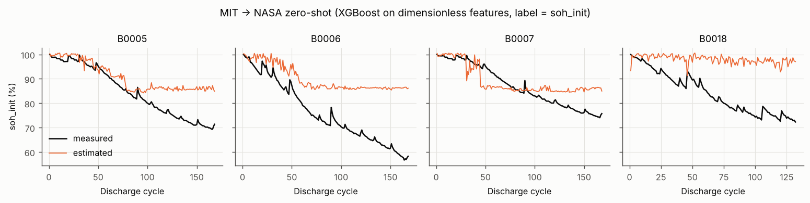

## 7. Explainability (O6)

Grouped permutation importance on 4,000 primary-test cycles (a feature is permuted together with its `d_`, `r_` and `_rm5` copies so correlated copies do not split the credit).

| Rank | Main model (A4) group | RMSE increase | BMS model (A2) group | RMSE increase |
|---|---|---|---|---|
| 1 | chg_ic_peak | 3.687 | chg_ic_peak | 2.415 |
| 2 | chg_v_start | 1.223 | chg_v_start | 1.792 |
| 3 | chg_cv_tau | 0.222 | chg_t_cv | 0.196 |
| 4 | chg_t_cv | 0.173 | chg_q_cv | 0.191 |
| 5 | chg_q_cv | 0.096 | IR | 0.153 |
| 6 | dq_min_log | 0.051 | chg_cv_tau | 0.143 |
| 7 | dq_var_log | 0.040 | chg_ic_peak_v | 0.082 |
| 8 | IR | 0.013 | chg_dT | 0.021 |
| 9 | chg_dT | 0.010 | Tavg | 0.014 |
| 10 | dq_mean | 0.009 | Tmax | 0.009 |

Top mean |SHAP| (main model): `chg_ic_peak_rm5` 2.33, `chg_ic_peak` 0.64, `d_chg_v_start` 0.52, `chg_v_start` 0.32, `chg_q_cv` 0.25, `chg_v_start_rm5` 0.25, `chg_t_cv` 0.19, `chg_cv_tau_rm5` 0.19

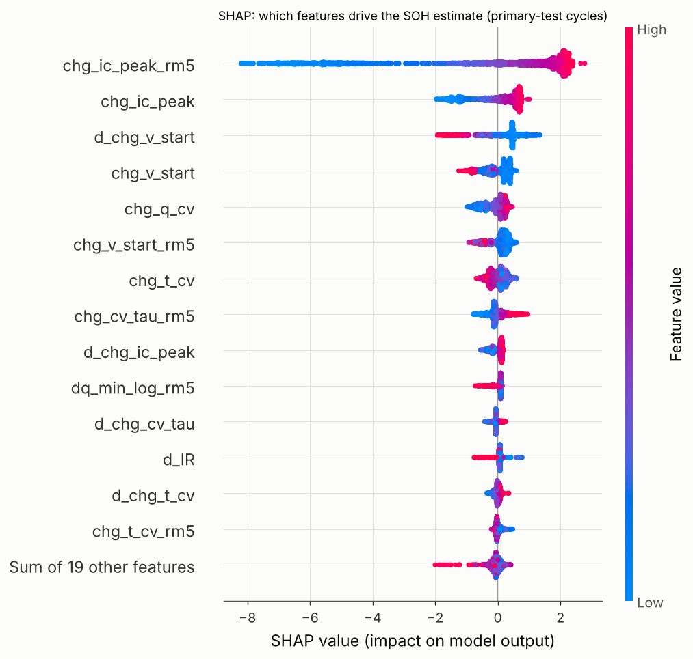

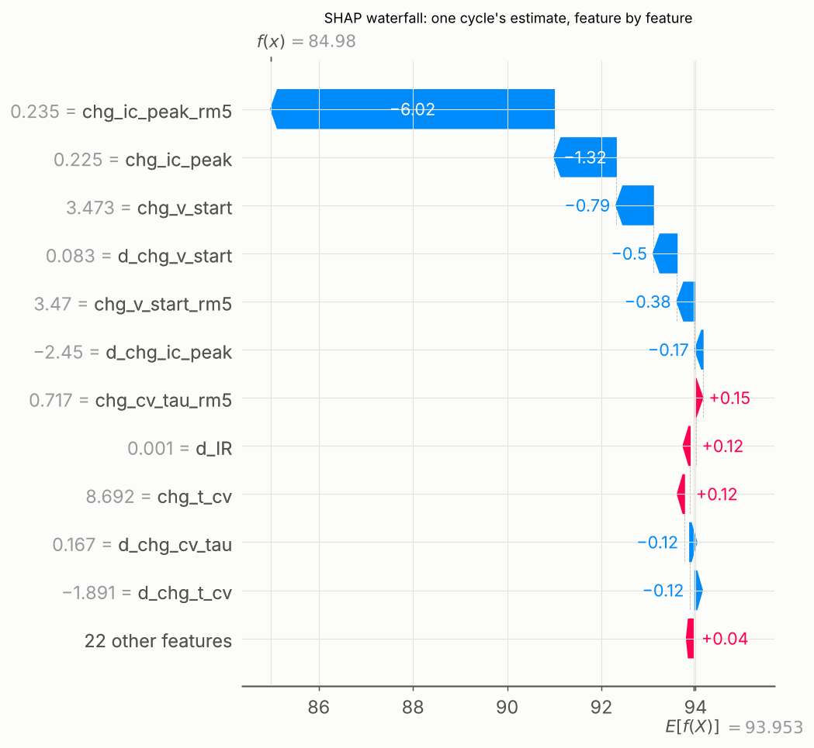

## 8. Deployment footprint — template R5 (O7)

| Model | Parameters / trees | File size (KB) | CPU inference per cycle (ms) | Needs full discharge? |
|---|---|---|---|---|
| XGBoost A4_plus_history | 1000 trees x depth<=6 | 3548 | 2.69 | yes (dQ(V) features) |
| XGBoost A2_bms_charge | 1000 trees x depth<=6 | 3507 | 1.93 | no (charge segment, IR, temperature) |
| Random Forest A4 | 300 trees, mean depth 32 | 749089 | 81.07 | yes (dQ(V) features) |
| Ridge A4 | 34 coefficients | 3 | 1.38 | yes (dQ(V) features) |
| LSTM (k=10) | 35361 | 142 | 0.45 | yes (dQ(V) features) |
| GRU (k=10) | 26657 | 108 | 0.47 | yes (dQ(V) features) |
| 1D-CNN (k=10) | 10561 | 48 | 0.27 | yes (dQ(V) features) |

Timing is single-cycle Python inference on one CPU core of the build machine (includes Python call overhead), not a microcontroller.

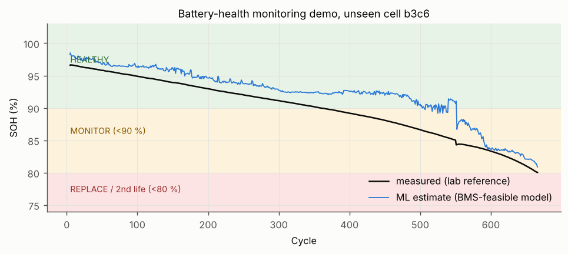

## 9. Reproducibility

| Item | Value |
|---|---|
| python | 3.13.16 |
| numpy | 2.5.3 |
| pandas | 3.0.5 |
| scikit-learn | 1.9.1 |
| xgboost | 3.4.1 |
| torch | 2.14.1+cpu |
| seeds | [0, 1, 2] |
| commit | 6fa4d1c |
| date | 2026-10-22 19:10 |
